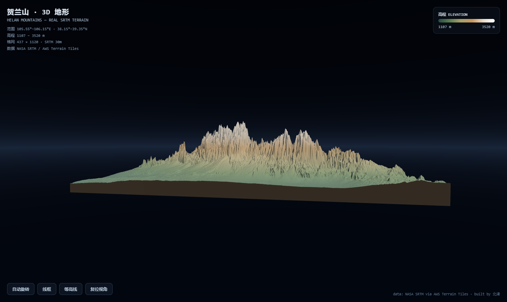

# 贺兰山 · 3D 地形展示 ⛰️

> 用真实卫星高程数据，在浏览器里重现宁夏贺兰山的立体山脊。

[在线演示](#-在线演示) · [特性](#-特性) · [快速开始](#-快速开始) · [数据来源](#-数据来源) · [技术细节](#-技术细节)



**贺兰山**位于宁夏回族自治区与内蒙古自治区交界处，南北绵延约 220 公里，
主峰敖包疙瘩海拔 3556 米。它挡住了腾格里沙漠的东侵，也造就了东侧
"塞上江南"银川平原——山体两侧的巨大高差（1100 m ↔ 3520 m）在这份
真实 SRTM 数据里清晰可见。

本项目将这一区域的真实高程数据渲染为可交互的 3D 地形，
纯浏览器运行，无需安装任何东西。

## ✨ 特性

- **真实数据** — NASA SRTM 30m 高程，经 AWS Terrain Tiles 分发，逐瓦片解码
- **高程分层设色** — 从盆地戈壁的深青到峰顶的雪白，一眼读懂地势
- **等高线模式** — 一键叠加 24 级等高线
- **线框模式** — 查看 49 万顶点的原始网格
- **自动环绕** — 打开即转，展示山体各角度
- **零依赖安装** — Three.js 已本地化，克隆即用，不依赖 CDN

## 🚀 快速开始

```bash
git clone https://github.com/ljh-ningxia/helan-3d.git
cd helan-3d
python -m http.server 8000
# 打开 http://localhost:8000
```

> ⚠️ 必须通过 HTTP 服务访问——直接双击 index.html 会因浏览器 CORS 策略
> 无法读取高程数据文件。

## 📡 在线演示

**👉 [https://ljh-ningxia.github.io/helan-3d/](https://ljh-ningxia.github.io/helan-3d/)**

打开即转，拖拽旋转，滚轮缩放。无需安装任何东西。

## 🗺️ 数据来源

| 项目 | 说明 |
|---|---|
| 高程数据 | [NASA SRTM](https://www2.jpl.nasa.gov/srtm/) 1 弧秒（约 30m） |
| 分发渠道 | [AWS Terrain Tiles](https://registry.opendata.aws/terrain-tiles/)（Terrarium PNG 编码） |
| 覆盖范围 | 105.55°–106.15°E, 38.15°–39.35°N（zoom 10，10 瓦片） |
| 高程范围 | 1107 – 3520 m |

重新抓取或调整区域：

```bash
pip install pillow
python tools/fetch_terrain.py
# 修改 tools/fetch_terrain.py 顶部的经纬度范围即可换一座山
```

## 🔧 技术细节

**数据管线**（`tools/fetch_terrain.py`）

```
AWS Terrain Tiles (PNG, Terrarium 编码)
  → R*256 + G + B/256 − 32768 = 海拔(m)
  → 裁剪至精确经纬度边界
  → uint16 紧凑二进制 (~956 KB)
```

**渲染**（`src/main.js`）

- `PlaneGeometry` 437 × 1120 段，逐顶点位移 + 顶点色
- 垂直方向 ~6 倍夸张（真实比例下 2.4km 高差在 60km 宽度上难以察觉）
- 裙边侧壁包裹，呈现实体地质块效果
- 自定义天空穹顶着色器 + 雾效 + 半球光

**二进制格式**（`data/helan_heightmap.bin`）

```
[uint32 宽][uint32 高][float32 最低高程][float32 最高高程]
[uint16 × 宽×高]  // 行优先，小端，海拔米
```

## 🛣️ Roadmap

- [ ] 卫星影像贴图叠加（Sentinel-2 / 地图瓦片）
- [ ] 水系与等高线标注（主峰、垭口地名）
- [ ] 视频导出（绕山飞行路线）
- [ ] 支持任意区域：前端直接解码 Terrarium 瓦片

## 📄 License

[MIT](LICENSE) · 数据版权归 NASA/USGS 各自协议所有

---

*I'm 北渚, a student learning in public — this is my first open-source project.*
*我是北渚，一名公开学习的学生——这是我的第一个开源项目。*
